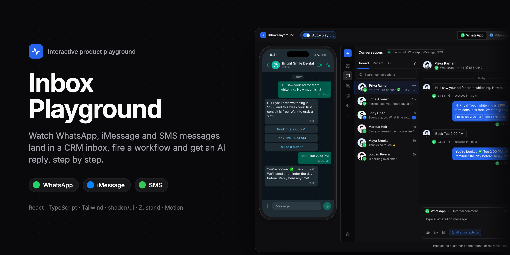
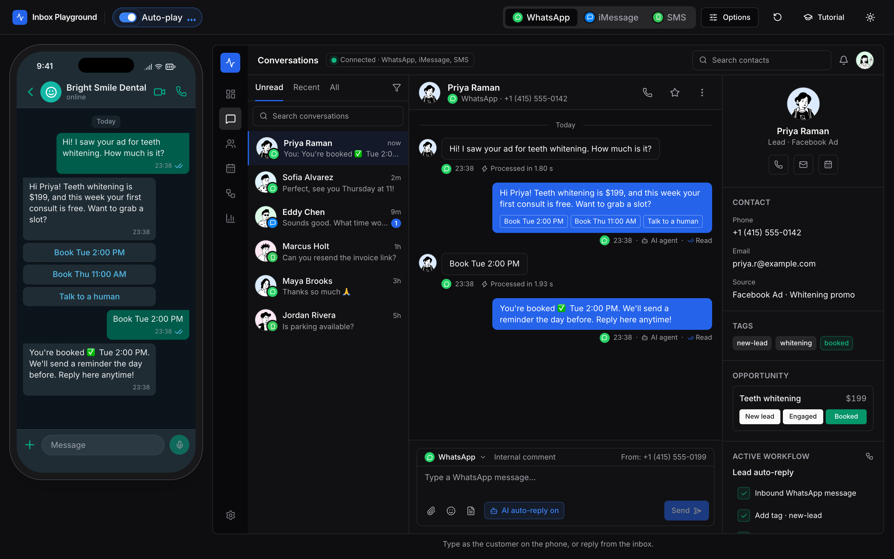
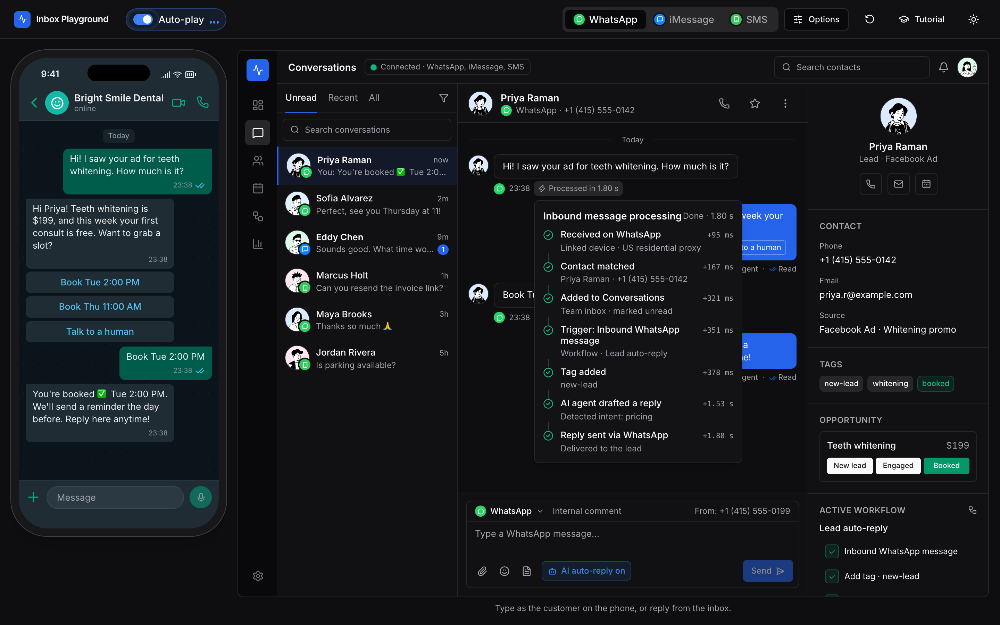
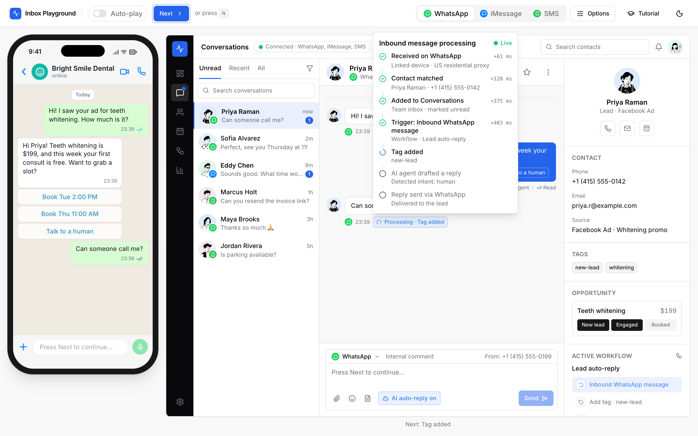
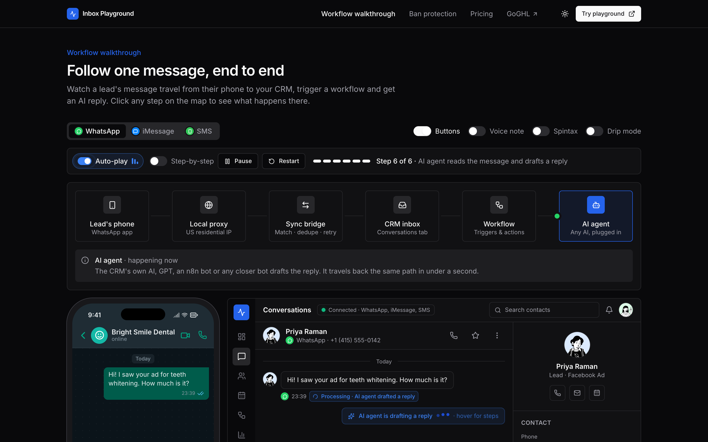
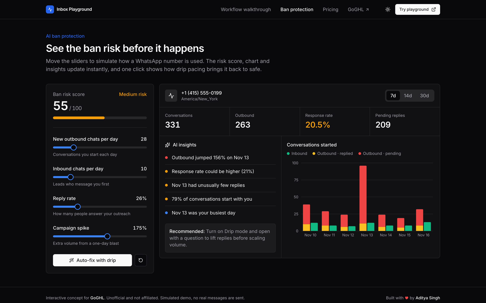
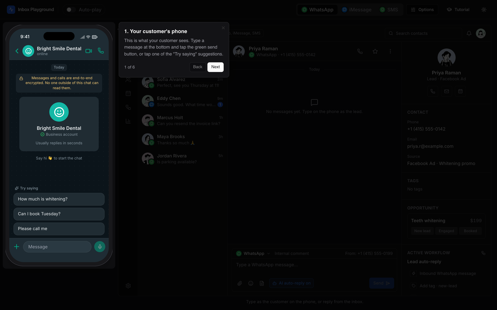
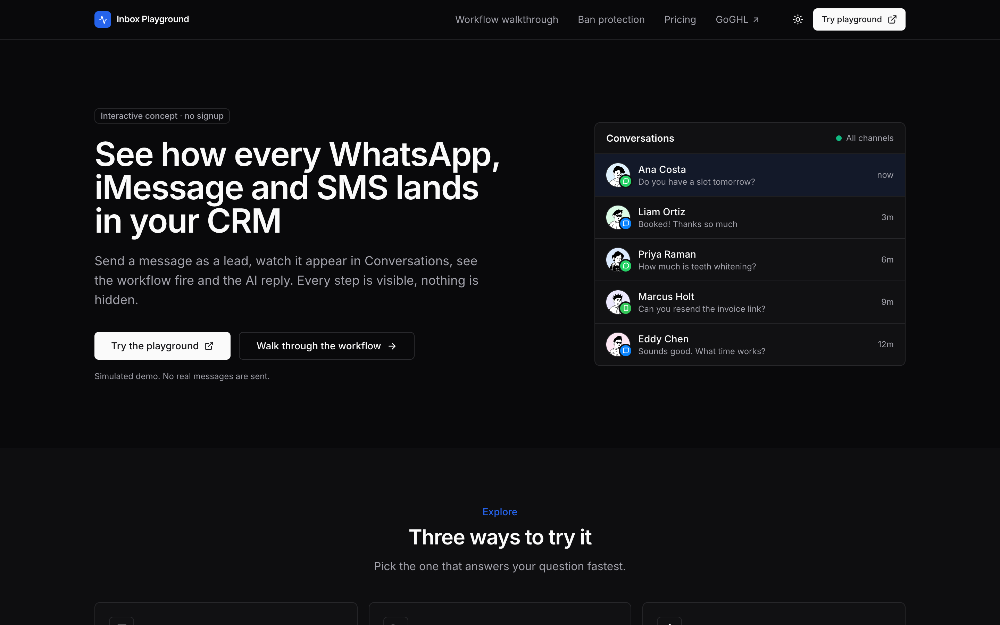
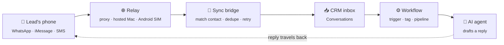
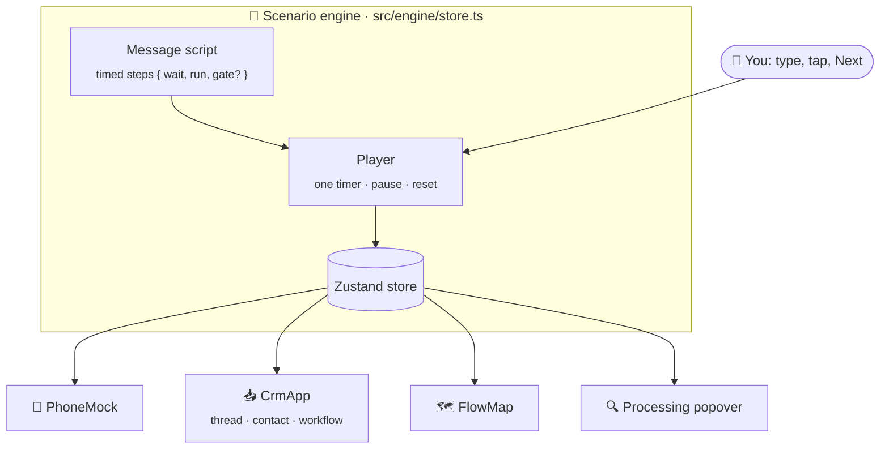

<div align="center">



<br />

# Inbox Playground

**Try a WhatsApp / iMessage / SMS → CRM integration in 60 seconds. No signup, no backend, nothing to install.**

<p>
  
  
  
  
  
  
  
</p>

[**Live demo**](#) &nbsp;·&nbsp; [Features](#-features) &nbsp;·&nbsp; [Screenshots](#-screenshots) &nbsp;·&nbsp; [How it works](#-how-it-works) &nbsp;·&nbsp; [Run it locally](#-run-it-locally)

</div>

---

## 💡 Why this exists

[GoGHL](https://goghl.ai) connects **WhatsApp, iMessage and SMS** to the GoHighLevel CRM, and is used by thousands of marketing agencies. Its landing page describes a lot of features: QR-code connection, hosted Macs, proxies, workflows, AI replies, ban protection and more.

**Reading about a product is slow. Using it is instant.** So I built a playground where anyone, technical or not, can *send a message as a customer* and watch exactly what happens to it.

> [!NOTE]
> This is an **unofficial product concept** built as a portfolio project. Everything is simulated in the browser. No real messages are sent and no data leaves the page.

---

## ✨ Features

<table>
<tr>
<td width="50%" valign="top">

### 📱 Phone + CRM, side by side
Type as the customer on a realistic **WhatsApp, iMessage or SMS** phone. The message lands in a CRM **Conversations** inbox on the right contact, with read receipts, typing indicators, quick-reply buttons and voice notes.

</td>
<td width="50%" valign="top">

### 🔍 See every step
Hover the **Processing** label under any message to see its full journey with timings: received → contact matched → added to inbox → workflow trigger → tag → AI reply → delivered.

</td>
</tr>
<tr>
<td valign="top">

### ▶️ Auto-play or chat yourself
**Auto-play** runs a demo conversation (price question → booking) by itself. Turn it off and chat yourself: replies still happen automatically. Want to go slower? **Step-by-step** makes each stage wait for **Next**.

</td>
<td valign="top">

### 🤖 Simulated AI agent
Replies are picked by intent (pricing, booking, call-back, greeting), with **buttons**, **voice notes**, **varied greetings** (spintax) and **human-like pacing** (drip). Turn AI off and reply as the team from the CRM composer.

</td>
</tr>
<tr>
<td valign="top">

### 🗺️ Workflow walkthrough
An animated map of the message path, **phone → relay → bridge → CRM → workflow → AI** and back, synced with the phone and inbox. Click any step for a plain-English explanation.

</td>
<td valign="top">

### 🛡️ Ban-risk sandbox
Move sliders for outbound volume, reply rate and campaign spikes. A **risk score**, KPIs, a daily chart and insights react instantly. **Auto-fix with drip** shows the fix.

</td>
</tr>
<tr>
<td valign="top">

### 🎓 Built for non-technical visitors
A 6-step **guided tutorial** on the first visit, "Try saying" suggestions inside the phone, and plain-English labels everywhere.

</td>
<td valign="top">

### 🌗 Polished details
**Light and dark** themes (follow the system, with a toggle), **keyboard shortcuts**, fits on one screen with no scrolling, responsive, and respects reduced motion.

</td>
</tr>
</table>

---

## 📸 Screenshots

<details open>
<summary><b>Playground</b>: a phone and a CRM inbox, live</summary>
<br />

</details>

<details open>
<summary><b>Processing trace</b>: hover any message to see what happened</summary>
<br />

</details>

<details>
<summary><b>Step-by-step mode</b>: follow a message one stage at a time (light theme)</summary>
<br />

</details>

<details>
<summary><b>Workflow walkthrough</b></summary>
<br />

</details>

<details>
<summary><b>Ban protection</b></summary>
<br />

</details>

<details>
<summary><b>Guided tutorial</b> and <b>landing page</b></summary>
<br />

<br /><br />

</details>

---

## 🧭 How it works

### The journey of one message



### Inside the app

One small **scenario engine** drives everything, so every panel moves in sync.



- **Each message is a script** of timed steps. One player runs them, with pause, resume and reset.
- **Each message carries a trace** (its processing steps and simulated timings), which the hover popover reads live.
- **Gates** turn the same script into step-by-step mode: the player stops before each gated step until **Next** is pressed.
- **Auto-play and step-by-step are separate switches.** Turning Auto-play off mid-demo finishes the current message and hands control back to you, so nothing ever gets stuck.

<details>
<summary><b>Project structure</b></summary>

```
src/
├─ engine/
│  ├─ data.ts          channels, contacts, copy
│  └─ store.ts         scenario player + app state (Zustand)
├─ components/
│  ├─ PhoneMock.tsx    WhatsApp / iMessage / SMS phone
│  ├─ CrmApp.tsx       CRM conversations, contact panel, processing popover
│  ├─ FlowMap.tsx      animated message-flow map
│  ├─ ModeControls.tsx Auto-play, Step-by-step, Next
│  ├─ tour.ts          guided tutorial (driver.js)
│  ├─ ui.tsx           design system primitives
│  └─ Site.tsx         nav, footer, product links
├─ pages/              Landing · Playground · Walkthrough · BanProtection
├─ sections/           Pricing calculator
└─ lib/                theme (light/dark) · helpers
```
</details>

---

## ⌨️ Keyboard shortcuts

| Key | Action |
|:---:|---|
| <kbd>A</kbd> | Auto-play on / off |
| <kbd>S</kbd> | Step-by-step on / off |
| <kbd>N</kbd> or <kbd>→</kbd> | Next step (in step-by-step mode) |
| <kbd>1</kbd> <kbd>2</kbd> <kbd>3</kbd> | WhatsApp / iMessage / SMS |
| <kbd>R</kbd> | Replay the demo |
| <kbd>T</kbd> | Light / dark theme |
| <kbd>?</kbd> | Show the tutorial |

---

## 🛠️ Tech stack

| Area | Choice |
|---|---|
| Framework | **React 19** + **TypeScript**, built with **Vite** |
| Design system | **Tailwind CSS** with the **[shadcn/ui](https://ui.shadcn.com) "Zinc"** colour tokens, light and dark, Inter font |
| State | **Zustand** |
| Animation | **Motion** (formerly Framer Motion) |
| Charts | **Recharts** |
| Tutorial | **driver.js** |
| Icons & avatars | **lucide-react**, **DiceBear** (generated locally, no network) |

---

## 🚀 Run it locally

```bash
git clone https://github.com/<your-username>/inbox-playground.git
cd inbox-playground
npm install
npm run dev          # → http://localhost:5173
```

```bash
npm run build        # production build in dist/
```

Deploy `dist/` to any static host. `vercel.json` already includes the rewrite for the client-side routes (`/playground`, `/walkthrough`, `/ban-protection`).

---

## ⚖️ Disclaimer

Independent, unofficial concept built as a portfolio project. **Not affiliated with or endorsed by GoGHL, HighLevel, WhatsApp or Apple.** All names, messages, timings and the "AI" replies are simulated (pre-written replies chosen by keyword). Prices were taken from GoGHL's public pricing page in November 2026, for illustration only.

👉 For the real product, visit **[goghl.ai](https://goghl.ai)**.

---

<div align="center">

Built with ♥ by **Aditya Singh**

</div>
